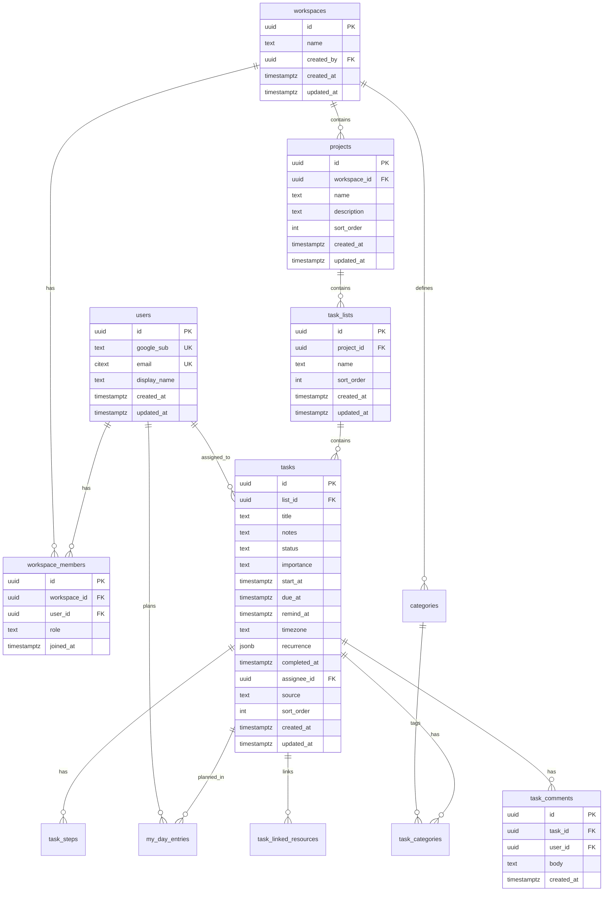
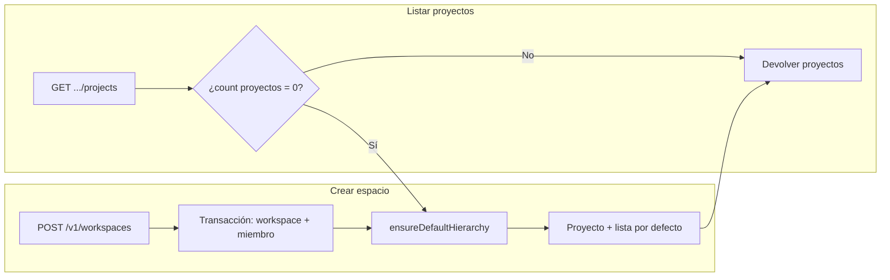

# Plan Constitutivo — DoTask

> Documento constitutivo del proyecto DoTask: aplicación de gestión de tareas tipo Microsoft To Do, multiplataforma, con soporte para equipos de trabajo.

---

## 1. Visión del producto

DoTask ofrece una experiencia de gestión de tareas personales y colaborativas inspirada en Microsoft To Do, con estas características diferenciadoras:

- **Organización jerárquica al estilo Microsoft To Do**: Workspace → Proyecto → Lista → Tarea → Pasos. Desde la migración `20261121120000_tareas_estilo_todo` ya no existe el nivel «hito».
- **Trabajo en equipo**: espacios de trabajo compartidos con roles (owner, member, guest), asignación de tareas y comentarios.
- **Multiplataforma**: una sola base de código React sirve como PWA en la web y como app nativa en Android/iOS vía Capacitor.

---

## 2. Stack tecnológico

| Capa | Tecnología | Notas |
|------|------------|-------|
| Frontend | React 19+, Vite 7, TypeScript | SPA con React Router; Vite 7 por compatibilidad con `vite-plugin-pwa` |
| UI | shadcn/ui | Componentes accesibles y consistentes |
| PWA | Manifest + Workbox (plugin Vite) | Shell offline limitado; datos desde API; en monorepo se fuerza una sola versión de Vite vía `overrides` en la raíz |
| Móvil | Capacitor (Android / iOS) | Empaqueta el build Vite |
| Backend | NestJS (TypeScript) | Módulos, DI, guards, pipes |
| ORM / Migraciones | Prisma | Migraciones versionadas, tipos generados |
| Base de datos | PostgreSQL | Fuente de verdad |
| Cache / Colas | Redis (BullMQ) | Rate limiting, notificaciones, recordatorios |
| Autenticación | Google (OAuth 2.0 / OpenID Connect) | Sin contraseñas locales; sesión propia firmada |
| Despliegue | Dokploy | Frontend estático, backend Node, Postgres, Redis |

**Idioma de la interfaz**: español.  
**Idioma del código** (variables, métodos, componentes): inglés.  
**Metodología de desarrollo**: TDD — siempre ejecutar pruebas y autocorregir errores.

---

## 3. Autenticación con Google

### Proveedor

El login es con cuenta de Google mediante OAuth 2.0 / OpenID Connect, sin intermediarios (librería oficial `google-auth-library`). DoTask no guarda contraseñas. Hasta noviembre de 2026 se usó WorkOS; las cuentas de esa etapa se vinculan por correo verificado en su primer login con Google.

### Flujo web / PWA

1. `GET /v1/auth/login` genera un `state` aleatorio y un verificador **PKCE** (S256), los guarda en una cookie httpOnly firmada de 10 minutos (`dotask_oauth`) y redirige a la pantalla de consentimiento de Google (alcances `openid email profile`).
2. Google devuelve al usuario a `GET /v1/auth/callback` con `code` y `state`. El servidor comprueba que el `state` coincide, canjea el código con el verificador PKCE y verifica el `id_token` (firma, audiencia = `GOOGLE_CLIENT_ID`, emisor de Google). Exige `email_verified`.
3. El usuario se busca por `google_sub`; si no existe, se vincula la cuenta con el mismo correo o se crea. Después se establece una **cookie httpOnly** de sesión (`dotask_session`) en el dominio del API. El valor es un token **firmado** con HMAC-SHA256 (`SESSION_SECRET`) que contiene el `userId` interno y su caducidad (7 días); sin el secreto no se puede fabricar.
4. En cada petición posterior, un guard de NestJS verifica la firma y la caducidad de la cookie, resuelve el usuario y lo adjunta al contexto (`@CurrentUser()`).
5. Cualquier error (cancelación, `state` inválido, correo sin verificar) redirige a `/login?error=cancelado|google` sin crear sesión.
6. Conector MCP de Claude: Google no permite el registro dinámico de clientes que usa claude.ai, así que DoTask es su propio servidor de autorización OAuth 2.1 (`/oauth/*`), que delega la identidad en este login de Google. El servidor MCP (`/mcp`) solo acepta `Authorization: Bearer` de ese servidor; la API REST solo acepta la cookie.

**Estado (punto 2.9): listo** — lectura: `list_workspaces`, `list_projects`, `list_lists`, `list_members`, `list_categories`, `list_tasks`, `list_tasks_for_chat`, `get_task`; escritura (scope `tasks:write`, nunca borra): `create_project`, `create_list`, `create_task`, `update_task`, `complete_task`, `add_step`, `toggle_step`, `add_to_my_day`, `link_task_to_chat`. Los cambios de Claude quedan marcados con `tasks.source = 'claude'`.

**Estado (Fase 1 de seguridad): listo** — sesión firmada, control de acceso por espacio en todas las rutas (incluidas tareas por id y comentarios), validación Zod con lista blanca de campos, `helmet`, límites de peticiones y canje atómico de invitaciones.

### Capacitor (iOS / Android)

Registrar en el cliente OAuth de Google los redirect URI adecuados:

- Producción: HTTPS del dominio real.
- Desarrollo: esquema custom `capacitor://` o `https://localhost` según la guía de Capacitor.

### Variables de entorno (backend)

| Variable | Descripción |
|----------|-------------|
| `GOOGLE_CLIENT_ID` | ID de cliente OAuth de Google |
| `GOOGLE_CLIENT_SECRET` | Secreto del cliente — **nunca** exponer en el cliente |
| `GOOGLE_REDIRECT_URI` | URI de callback del API, registrada en Google Cloud Console |
| `SESSION_SECRET` | Firma HMAC de las cookies (obligatoria, 32+ caracteres) |

En Vite se usa **`VITE_API_URL`** (URL pública del API) embebida en el build; sin ella el login redirige al dominio del front en lugar del backend. Ver [DEPLOY-DOKPLOY.md](DEPLOY-DOKPLOY.md).

### Equipos

Los workspaces de DoTask son entidad propia en Postgres y no dependen del proveedor de identidad.

---

## 4. Estructura de la base de datos

### 4.1 Convenciones

- Claves primarias: `uuid` con `gen_random_uuid()`.
- Timestamps: `timestamptz`.
- Nombres de tablas y columnas: `snake_case`.
- Extensión `citext` para emails case-insensitive.

### 4.2 Jerarquía de contenido

```
Workspace → Project → TaskList → Task → TaskStep
```

- Cada workspace contiene uno o más proyectos.
- Cada proyecto contiene listas de tareas.
- Las tareas pertenecen a una lista concreta y tienen pasos (checklist), como en Microsoft To Do.
- **Migración desde hitos** (`20261121120000_tareas_estilo_todo`): las listas pasaron al proyecto; si un proyecto tenía varios hitos con listas, la lista quedó como «Hito – Lista»; un hito sin listas quedó como una lista vacía con su nombre. Las subtareas (a cualquier profundidad) se convirtieron en pasos de su tarea raíz; sus fechas, responsable y notas se anexaron a las notas de esa tarea y sus comentarios pasaron a ella. Las tareas canceladas pasaron a `deferred` y la prioridad a importancia (`high` → `high`, `low` → `low`, resto → `normal`).

**Invariante de producto (semilla mínima):** todo workspace válido para uso en la app debe poder listar al menos **una** cadena `Proyecto → Lista` sin que el usuario tenga que crearla a mano. El backend lo garantiza así:

1. **`POST /v1/workspaces`**: al crear un espacio, se inserta en la misma operación (transacción) la semilla por defecto: proyecto **Mi Proyecto** con la lista **Tareas** (orden `sort_order = 0` en cada nivel).
2. **`GET /v1/workspaces/:wid/projects`**: si el espacio existiera sin proyectos (p. ej. datos legados, scripts de aprovisionamiento o un workspace creado fuera de este flujo), antes de devolver la lista el API ejecuta una **reparación idempotente**: solo si no hay proyectos, crea esa misma jerarquía mínima. Así el diagrama ER (workspace con muchos projects) sigue siendo cierto en modelo de datos, pero en UX el usuario nunca se queda sin rama para crear tareas.

### 4.3 Diagrama entidad-relación

El diagrama refleja el **modelo relacional** (cardinalidades máximas). No muestra reglas de negocio dinámicas: en la práctica, DoTask asegura que cada workspace tenga al menos un proyecto (y debajo una lista) mediante la semilla descrita en §4.2.



#### Flujo de la semilla (creación y reparación)



### 4.4 Tablas y columnas (detalle)

#### `users`

| Columna | Tipo | Notas |
|---------|------|-------|
| `id` | `uuid` | PK interna |
| `google_sub` | `text` | Único, nulo solo en cuentas aún no vinculadas o la de desarrollo; `sub` del `id_token` de Google |
| `email` | `citext` | Único; sincronizado desde Google (siempre verificado) |
| `display_name` | `text` | Nombre visible; desde Google |
| `created_at`, `updated_at` | `timestamptz` | |

Índices únicos en `google_sub` y `email`. Sin `password_hash`: las credenciales viven en Google.

**Sesión y tokens**: cookie propia firmada con HMAC-SHA256 (`SESSION_SECRET`), sin guardar tokens de Google. La tabla `refresh_tokens` no forma parte del núcleo; se añade como opcional si se emiten tokens propios de larga duración.

#### `workspaces`

| Columna | Tipo | Notas |
|---------|------|-------|
| `id` | `uuid` | PK |
| `name` | `text` | |
| `created_by` | `uuid` | FK → `users(id)` |
| `created_at`, `updated_at` | `timestamptz` | |

**Regla de producto (onboarding explícito)**: el login con Google solo hace upsert del usuario. **No se crea ningún workspace automáticamente en el flujo de callback de este repositorio.** Si el usuario no tiene membresía en ningún espacio, el frontend muestra una vista de onboarding donde puede: (a) crear un espacio de trabajo nuevo (`POST /v1/workspaces`, que genera la semilla proyecto/lista en transacción), o (b) unirse a un espacio existente aceptando un código de invitación (`POST /v1/invitations/accept`). Si en despliegue se añade un workspace por otros medios (script, otro servicio) y quedara vacío de proyectos, el primer `GET /v1/workspaces/:wid/projects` aplicará la misma semilla (ver §4.2).

#### `workspace_members`

| Columna | Tipo | Notas |
|---------|------|-------|
| `id` | `uuid` | PK |
| `workspace_id` | `uuid` | FK → `workspaces(id)` ON DELETE CASCADE |
| `user_id` | `uuid` | FK → `users(id)` ON DELETE CASCADE |
| `role` | `text` | `owner` / `member` / `guest` |
| `joined_at` | `timestamptz` | |

Restricción única: `(workspace_id, user_id)`. Índice en `(user_id)`.

#### `projects`

| Columna | Tipo | Notas |
|---------|------|-------|
| `id` | `uuid` | PK |
| `workspace_id` | `uuid` | FK → `workspaces(id)` ON DELETE CASCADE |
| `name` | `text` | |
| `description` | `text` | Nullable |
| `sort_order` | `int` | Orden dentro del workspace |
| `created_at`, `updated_at` | `timestamptz` | |

Índice: `(workspace_id, sort_order)`.

#### `task_lists`

| Columna | Tipo | Notas |
|---------|------|-------|
| `id` | `uuid` | PK |
| `project_id` | `uuid` | FK → `projects(id)` ON DELETE CASCADE |
| `name` | `text` | |
| `sort_order` | `int` | Orden dentro del proyecto |
| `created_at`, `updated_at` | `timestamptz` | |

Índice: `(project_id, sort_order)`.

#### `tasks`

| Columna | Tipo | Notas |
|---------|------|-------|
| `id` | `uuid` | PK |
| `list_id` | `uuid` | FK → `task_lists(id)` ON DELETE CASCADE |
| `title` | `text` | |
| `notes` | `text` | Nullable |
| `notes_updated_at` | `timestamptz` | Nullable |
| `status` | `text` | `not_started`, `in_progress`, `waiting_on_others`, `deferred`, `completed` (CHECK) |
| `importance` | `text` | `low`, `normal`, `high` (CHECK); `high` = estrella «Importante» |
| `start_at` | `timestamptz` | Nullable |
| `due_at` | `timestamptz` | Nullable. Desde la app, una fecha sin hora se guarda como las 23:59 locales |
| `remind_at` | `timestamptz` | Nullable; dispara la notificación push |
| `timezone` | `text` | Nullable; IANA, con ella se calculan las repeticiones |
| `recurrence` | `jsonb` | Nullable; `{ pattern: { type: daily\|weekly\|monthly\|yearly, interval, daysOfWeek? }, range: { type: noEnd\|endDate\|numbered, endDate?, numberOfOccurrences? } }` (forma simplificada de `patternedRecurrence` de Microsoft Graph) |
| `completed_at` | `timestamptz` | Nullable; lo fija el servidor |
| `assignee_id` | `uuid` | Nullable; FK → `users(id)` ON DELETE SET NULL |
| `source` | `text` | `user` o `claude` (último cambio) |
| `reminder_sent_at`, `overdue_notified_at` | `timestamptz` | Control de avisos push |
| `sort_order` | `int` | Orden dentro de la lista |
| `created_at`, `updated_at` | `timestamptz` | |

Índices: `(list_id, sort_order)`, `(assignee_id)`, `(due_at)`, `(remind_at)`.

**Repetición:** al completar una tarea que se repite, el servidor crea la siguiente en la misma transacción (mismas notas, importancia, responsable, categorías y pasos sin marcar), con las fechas desplazadas según el patrón y calculadas en la hora local de `timezone` (respeta cambios de horario). La tarea completada pierde la repetición para que reabrirla no duplique la serie.

#### `task_steps`

Pasos de una tarea (`checklistItem` de To Do): `id`, `task_id` (FK cascade), `title`, `is_checked`, `checked_at`, `sort_order`, `created_at`. Índice `(task_id, sort_order)`.

#### `categories` y `task_categories`

Categorías por **espacio de trabajo**: `categories(id, workspace_id, name, color, created_at)` con único `(workspace_id, name)`; colores `red, orange, yellow, green, teal, blue, purple, pink, gray`. `task_categories(task_id, category_id)` con PK compuesta. Una tarea solo puede usar categorías de su espacio.

#### `task_linked_resources`

Recursos vinculados (`linkedResource` de To Do): `id`, `task_id`, `application_name` (`Google Drive`, `Claude`, `Web`), `display_name`, `external_id`, `web_url`, `mime_type`, `created_at`. **DoTask no almacena archivos**: de Google Drive solo se guarda el enlace (se valida que sea `drive.google.com` o `docs.google.com`); de Claude, el enlace al chat (`claude.ai`). El mismo enlace no se duplica en una tarea.

#### `task_comments`

| Columna | Tipo | Notas |
|---------|------|-------|
| `id` | `uuid` | PK |
| `task_id` | `uuid` | FK → `tasks(id)` ON DELETE CASCADE |
| `user_id` | `uuid` | FK → `users(id)` ON DELETE RESTRICT (columna obligatoria; no aplica SET NULL) |
| `body` | `text` | |
| `created_at` | `timestamptz` | |

Índice: `(task_id, created_at)`.

#### `workspace_invitations`

| Columna | Tipo | Notas |
|---------|------|-------|
| `id` | `uuid` | PK |
| `workspace_id` | `uuid` | FK → `workspaces(id)` ON DELETE CASCADE |
| `token_hash` | `text` | Único; SHA-256 del código de invitación |
| `role` | `text` | Rol asignado al aceptar (`member` por defecto) |
| `invited_by_user_id` | `uuid` | FK → `users(id)` |
| `expires_at` | `timestamptz` | 7 días desde creación |
| `consumed_at` | `timestamptz` | Nullable; fecha de aceptación |
| `created_at` | `timestamptz` | |

Índice: `(workspace_id)`. Único en `token_hash`.

Endpoints:
- `POST /v1/workspaces/:wid/invitations` — solo owners; devuelve código de un solo uso.
- `POST /v1/invitations/accept` — body `{ code }`; crea membresía y marca invitación consumida.

### 4.5 Enumeraciones

- `workspace_members.role`: `owner`, `member`, `guest`.
- `tasks.status`: `not_started`, `in_progress`, `waiting_on_others`, `deferred`, `completed` (los de Microsoft To Do; ya no existe `cancelled`).
- `tasks.importance`: `low`, `normal`, `high`.

### 4.6 Extensiones Postgres

- `citext` para `users.email`.
- `pg_trgm` (roadmap) para búsqueda full-text en títulos y notas.

### 4.7 Roadmap de esquema

- ~~`task_attachments`~~: descartado. Los archivos se enlazan desde Google Drive (`task_linked_resources`).
- Otros proveedores de identidad (Microsoft, correo mágico) si se necesitan.
- ~~Notificaciones: colas en Redis con BullMQ usando `tasks.remind_at`.~~ Hecho sin colas: ver §4.8.

### 4.8 Mi día y notificaciones push — ✅ listo

**`my_day_entries`** — "Mi día" personal por usuario (como Microsoft To Do).

| Columna | Tipo | Notas |
|---------|------|-------|
| `user_id` | `uuid` | FK → `users(id)`, cascade |
| `task_id` | `uuid` | FK → `tasks(id)`, cascade |
| `day` | `date` | Fecha **local** del usuario en que la eligió |

Único `(user_id, task_id)`; índice `(user_id, day)`. La lista se "reinicia" sola: solo se muestran las entradas cuyo `day` es hoy. Las pendientes de días anteriores aparecen en las sugerencias.

**`push_subscriptions`** — dispositivos con Web Push (VAPID): `user_id`, `endpoint` (único), `p256dh`, `auth`, `user_agent`, `last_used_at`. Se borran solas cuando el servicio de push responde 404/410.

**`tasks.reminder_sent_at` / `tasks.overdue_notified_at`** — marcan el aviso ya enviado; se limpian al cambiar `remind_at` / `due_at`.

Envío: `TaskAlertsService` revisa cada minuto (en el propio API, sin Redis) los recordatorios que llegaron a su hora (ventana de 1 h) y las tareas vencidas (ventana de 24 h). Cada aviso se reclama con un `UPDATE … WHERE …_at IS NULL`, así que no se duplica con varias réplicas. Destinatario: el responsable o, si no tiene, los miembros del espacio. Llega a Android (Chrome y la app TWA), escritorio e iPhone/iPad con la PWA instalada en la pantalla de inicio (iOS 16.4+).

---

## 5. API y seguridad

- REST versionada: `/v1/...`, JSON, errores normalizados.
- **Multi-tenant** por `workspaceId`; recursos anidados siguiendo la jerarquía:

```
/v1/workspaces/:wid/projects
/v1/workspaces/:wid/projects/:pid/lists
/v1/workspaces/:wid/lists/:lid/tasks            # GET (resumen con ?day…) y POST
/v1/workspaces/:wid/tasks/:id                   # GET detalle, PATCH, DELETE
/v1/workspaces/:wid/tasks/:id/steps[/:sid]      # pasos
/v1/workspaces/:wid/tasks/:id/links[/:rid]      # Google Drive, chats de Claude, web
/v1/workspaces/:wid/categories[/:id]
/v1/integrations/google-drive                   # configuración pública del selector (Google Picker)
```

Listas inteligentes, Mi día y push (✅ listo):

```
GET    /v1/workspaces/:wid/navigation              # proyectos → listas con pendientes
GET    /v1/workspaces/:wid/smart/counts?day&dayStart&dayEnd
GET    /v1/workspaces/:wid/smart/:kind?day&dayStart&dayEnd   # my-day | important | planned | assigned | all
GET    /v1/workspaces/:wid/my-day/suggestions?day&dayStart&dayEnd
PUT    /v1/workspaces/:wid/my-day/:taskId          # body { day }
DELETE /v1/workspaces/:wid/my-day/:taskId
GET    /v1/push/config                             # clave pública VAPID
POST   /v1/push/subscriptions | DELETE /v1/push/subscriptions | POST /v1/push/test
```

`day` es la fecha local del usuario (AAAA-MM-DD) y `dayStart`/`dayEnd` los límites de su día en ISO: el servidor no adivina zonas horarias.

- Siempre validar que cada entidad hija pertenece a la cadena del workspace indicado.
- Rutas protegidas: solo accesibles con sesión válida de un usuario autenticado con Google.
- CORS configurado para dominio PWA y orígenes de Capacitor.
- Variables de entorno por servicio en Dokploy; sin secretos en el bundle del frontend.

---

## 6. Despliegue en Dokploy

La guía operativa completa (Compose, Traefik, `dokploy-network`, builds, migraciones Prisma y checklist) está en **[docs/DEPLOY-DOKPLOY.md](DEPLOY-DOKPLOY.md)**. Aquí solo el resumen ejecutivo.

| Servicio | Rol |
|----------|-----|
| Frontend | Artefacto estático de `vite build` servido por nginx (`apps/web/Dockerfile`) |
| Backend | Contenedor Node (Nest); arranque con `prisma migrate deploy` (`apps/api/Dockerfile`) |
| Postgres | Volumen persistente; migraciones versionadas en `apps/api/prisma/migrations/` |
| Redis | Persistencia opcional (AOF si aplica) |

- Red interna entre API, Postgres y Redis; **además** `dokploy-network` en `api` y `web` para Traefik (ver guía de despliegue).
- SSL en el proxy (Traefik / Dokploy); dominios de API y front documentados en la guía de despliegue.
- En Google Cloud Console: URI de redirección = callback del API en HTTPS.

### Variables de entorno requeridas

**Backend** (Dokploy Environment; no commitear `.env`):

| Variable | Descripción |
|----------|-------------|
| `DATABASE_URL` | Cadena de conexión PostgreSQL |
| `REDIS_URL` | Cadena de conexión Redis |
| `GOOGLE_CLIENT_ID` | ID de cliente OAuth de Google |
| `GOOGLE_CLIENT_SECRET` | Secreto del cliente OAuth |
| `GOOGLE_REDIRECT_URI` | URI de callback (registrada en Google), p. ej. `https://<api-host>/v1/auth/callback` |
| `SESSION_SECRET` | Firma de las cookies de sesión (32+ caracteres) |
| `FRONTEND_URL` | URL pública **HTTPS** del frontend (CORS y redirects post-login) |
| `NODE_ENV` | `production` |
| `PORT` | Puerto del servidor (default 3000) |

**Build del frontend** (argumento de build en Compose, no runtime en el contenedor nginx):

| Variable / arg | Descripción |
|----------------|-------------|
| `VITE_API_URL` | URL pública del backend; obligatoria en el **build** Docker (definir en Dokploy o usar el default del `docker-compose.yml`) |

El `docker-compose.yml` del repo **no** usa `env_file: apps/api/.env`; las variables se inyectan desde Dokploy.

---

## 7. Estructura del repositorio

```
DoTask/
├── apps/
│   ├── web/          # React + Vite + PWA + Capacitor
│   └── api/          # NestJS + Prisma
├── packages/
│   └── shared/       # Tipos, DTOs, validaciones Zod compartidas
├── docs/             # Plan constitutivo, despliegue Dokploy y arquitectura
├── docker-compose.yml
└── README.md
```

---

## 8. Fases de entrega

1. **Fundaciones**: login con Google, upsert usuario, workspace semilla, proyectos, listas y tareas CRUD (jerarquía completa), despliegue Dokploy (API + Postgres + Redis + secretos WorkOS + migraciones Prisma versionadas + guía [DEPLOY-DOKPLOY.md](DEPLOY-DOKPLOY.md)).
2. **Colaboración**: miembros, roles, asignaciones, listas compartidas en el marco del mismo workspace/proyecto.
3. **PWA + Capacitor**: manifest, service worker, builds iOS/Android, deep links.
4. **Redis**: cache de lectura (las notificaciones ya no dependen de Redis, ver 5).
6. **Tareas estilo To Do** (✅ listo): sin hitos; pasos, estados de To Do, importancia, inicio, repetición, categorías por espacio, archivos de Google Drive y chats de Claude vinculados; panel de detalle a la derecha (pantalla completa en el celular); conector MCP con edición y completado.
5. **Experiencia To Do** (✅ listo): barra lateral con listas inteligentes (Mi día, Importante, Planeado, Asignado a mí, Tareas) y contadores, árbol de proyectos plegable con búsqueda, panel móvil; Mi día con sugerencias; alertas push de recordatorios y tareas vencidas.

---

## 9. Criterios de calidad

- **TDD**: toda funcionalidad se desarrolla con tests primero; las pruebas se ejecutan y los errores se autocorrigen antes de dar por completada la tarea.
- **DRY**: métodos y componentes recursivos y reutilizables.
- **Componentes**: el frontend se estructura en componentes pequeños y enfocados, no en páginas monolíticas.
- **Idioma**: interfaz de usuario en español; código (variables, métodos, componentes) en inglés.
- **UI**: componentes shadcn/ui como base; construir componentes custom a partir de ellos cuando sea necesario.

---

## 10. Decisiones formalizadas

- **React + Vite + Capacitor + PWA** como frontend único.
- **PostgreSQL** como fuente de verdad.
- **Modelo de dominio**: Workspace → Proyecto → Lista → Tarea → Pasos (estilo Microsoft To Do; el nivel «hito» se eliminó el 2026-11-21).
- **Redis** previsto para cache y colas cuando el producto lo requiera.
- **NestJS** como framework de backend.
- **Login**: cuenta de Google (OAuth 2.0 / OIDC); usuarios identificados por `google_sub`, sin contraseñas locales.
- **Prisma** como ORM con migraciones versionadas.
